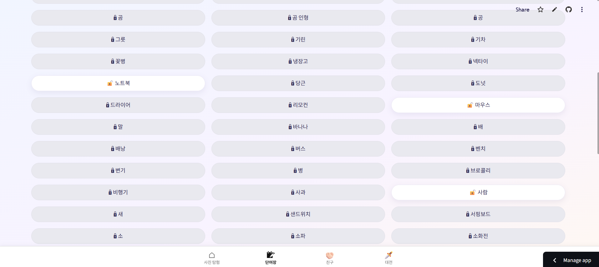
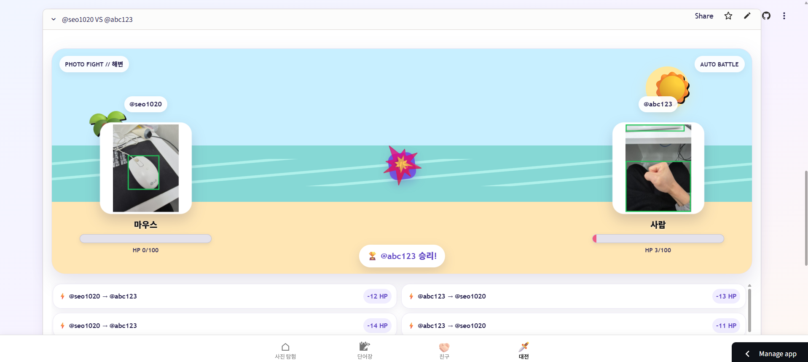

# 📸 찍으면서 배우는 우리 아이 첫 단어장 (Snap & Learn)

> **"놀이처럼 즐기는 영유아·어린이 맞춤형 사물 인식 단어 학습 서비스"**

---

## 💡 주제 및 만든 이유 (기획 배경)

### 해결하고자 했던 문제
* **지루한 단어 학습:** 기존의 책이나 플래시카드를 통한 단어 공부는 아이들에게 쉽게 지루함을 유발하여 집중력이 떨어지는 모습을 자주 볼 수 있었습니다.
* **아이들의 행동 특성 활용:** 아이들은 호기심이 많고, 특히 스마트폰이나 카메라로 주변 사물을 직접 찍고 탐색하는 놀이를 무척 좋아합니다.

### 기획 의도
**"아이가 좋아하는 행동(사진 찍기)을 그대로 학습으로 연결할 수는 없을까?"**라는 고민에서 출발했습니다. 
아이가 직접 카메라로 주변 사물을 비추거나 촬영하면, AI가 사물을 인식해 화면에 단어를 띄워주고 음성으로 읽어줍니다. 놀이를 하듯 자연스럽게 사물의 이름과 발음을 익힐 수 있도록 기획했습니다.

---

## 🛠 사용 모델 및 라이브러리

* **Object Detection (객체 인식):** `YOLO (You Only Look Once)`
  * 실시간으로 카메라에 비친 사물을 빠르고 정확하게 탐지하기 위해 사용했습니다.
* **TTS (Text-to-Speech):** `gTTS (Google Text-to-Speech)`
  * 인식된 사물의 단어를 아이들이 따라 읽기 쉽도록 자연스러운 음성으로 변환하여 들려주기 위해 사용했습니다.

---

## 🖥 실행 화면 캡처

> *아래 이미지 경로를 실제 캡처하신 이미지 파일 경로로 수정해 주세요.*

| 단어장 | 대전 |
| :---: | :---: |
|  |  |
| *카메라로 사물을 비추고 단어장에 등록해서 잠금을 푼 모습* | *저장된 사진으로 친구와 대전을 벌이는 모습* |

---

## 🔥 어려웠던 점과 해결 방법 (회고)

### 1. 초기 기획의 막막함과 빠른 진척
* **어려웠던 점:** 처음 프로젝트를 시작할 때, 어떤 주제를 선정하고 구체화할지 **기획 단계가 가장 힘들었습니다.** 하지만 막상 방향을 잡고 개발에 들어가니 예상했던 초기 기획 기능을 생각보다 훨씬 빠르게 구현해 버려, 이후 방향성을 어떻게 확장할지 고민이 되었습니다.
* **해결 방법:** 강사님의 피드백을 참고하여 실제 동작하는 결과물을 보면서 필요한 기능들을 하나씩 살을 붙여 나갔습니다.

### 2. 영유아 눈높이에 맞는 UI 선정
* **어려웠던 점:** 주 사용자가 어린아이들이다 보니, 기존 서비스들처럼 복잡한 텍스트나 버튼이 많은 UI는 적합하지 않았습니다. 직관적이면서도 아이들의 흥미를 끌 수 있는 UI를 선정하고 배치하는 과정이 까다로웠습니다.
* **해결 방법:** 완벽한 디자인을 한 번에 찾으려 하기보다, 여러 디자인들을 참고해 직접 화면을 구성해 보고 수정하는 과정을 반복했습니다. **"일단 해보자"는 마음으로 꾸준히 구현하다 보니 자연스럽게 최적의 UI와 완성도 있는 결과물을 만들어낼 수 있었습니다.**